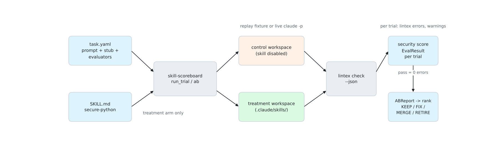
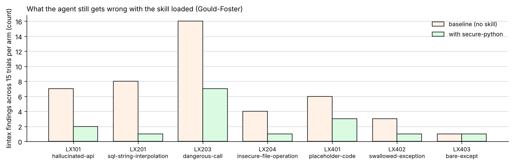

Teams write Claude Code skills like `secure-python` and assume they work. I wanted a number instead of an assumption, so I wired two of my open-source tools together:

- [`skill-scoreboard`](https://pypi.org/project/skill-scoreboard/) runs a task with and without a skill and compares the two arms.
- [`lintex`](https://pypi.org/project/lintex/) is an AST linter for the mistakes coding agents make: SQL built with f-strings, `shell=True`, swallowed exceptions, hallucinated APIs, and "rest unchanged" placeholder comments.

The idea is simple. Run the A/B, lint every file each run produced, and let the lint findings decide whether a run passed.



## One caveat first

The agent runs in this write-up are **simulated**. I generated them offline as recorded `claude -p` streams, with security mistakes planted at known rates: 60% per slot for the baseline, 12% with the skill loaded. Everything downstream is real: the linting, the scoring, the ranking, the hook.

So this post does not prove that a skill helps a real model. It shows that the measurement pipeline works, and that it recovers a known answer from the files alone.

## The scoring rule

A run passes only if lintex finds zero errors in the code the agent wrote.

| Input | Weight |
|---|---|
| lintex error (injection, dangerous call, swallowed exception) | -0.20 each |
| lintex warning (bare `except`, deprecated API) | -0.05 each |
| Pass | zero errors |

## What the A/B showed

Three tasks, five trials per arm, thirty linted workspaces.

| Rule | Baseline findings | With skill |
|---|---|---|
| LX203 dangerous-call | 16 | 7 |
| LX201 sql-string-interpolation | 8 | 1 |
| LX101 hallucinated-api | 7 | 2 |
| LX401 placeholder-code | 6 | 3 |
| LX204 insecure-file-operation | 4 | 1 |
| LX402 swallowed-exception | 3 | 1 |
| LX403 bare-except | 1 | 1 |



The pass-rate lift was +80, +80 and +40 percentage points across the three tasks, and `skill-scoreboard rank` returned **KEEP**.

The skill bars are not zero. One treatment run per task never loaded the skill at all, and those runs look exactly like the baseline. A skill only works when it is loaded.

## The case that matters: installed, and never used

Then I gave the same skill a different kind of task: a CLI helper that compresses, archives and ships a CSV. The prompt never mentions a database or an HTTP client.

The result was that both arms looked identical. The skill activated in 0 of 5 treatment runs, and lintex flagged `shell=True`, `os.system` and `eval` on the same lines as the baseline. `skill-scoreboard rank` said **FIX**, with the reason "adherence 0.00: tasks pass without the skill being used".

The skill's rules were correct. Its description just did not match the words in the task, so the model never routed to it.

I made two changes:

1. Rewrote the description to name the tooling vocabulary (compress, archive, copy, ship) and added a worked example.
2. Added `lintex hook claude-code` as a `PostToolUse` hook, so every edit is linted and findings go straight back to the model.

| | Before | After |
|---|---|---|
| Skill activation | 0% | 100% |
| LX203 findings | 11 | 5 |
| Mean lintex errors per file | 2.2 | 1.0 |
| Pass rate | 20% | 20% |
| Verdict | FIX | KEEP |
| Residual files blocked by the hook | not installed | 4 of 4 |

The pass rate did not move. Even when the skill loads, it still misses some cases, so most files still carried one error. That is why the hook matters: every one of those residual files exited with code 2 and a fix message for the model.

## Does lintex find what was planted?

Because I planted every issue, I could grade the linter against an answer key, and run ruff with the bandit rules on the same files.

| Tool | Recall | Precision |
|---|---|---|
| lintex | 107 of 107 | 100% |
| ruff (bandit `S` rules + defaults) | 84% | 63% |

Read this with care. The planted issues are the patterns lintex was built to catch, so this is a best case, not a real-world rate. ruff missed the placeholder comments and `TODO` stubs, which have no security call to match. Most of its extra findings were `S603` and `S607` on the safe list-form `subprocess.run`, which is the form the skill prescribes.

## What I took from it

- Measure activation before you measure quality. A skill that never loads scores the same as no skill.
- A skill description is a routing rule. Test it against prompts that do not use your vocabulary.
- A skill reduces mistakes and a hook catches the rest. I would not ship one without the other.

## Run it yourself

The full notebook runs offline with no API key, and takes a few seconds per task:

- Notebook: [07-secure-coding-skills.ipynb](https://github.com/700799/notebooks/blob/main/07-secure-coding-skills.ipynb)
- All nine notebooks: [github.com/700799/notebooks](https://github.com/700799/notebooks)

```bash
pip install lintex skill-scoreboard
```

If you run it against a live model with real skills, I would like to hear whether the activation problem shows up for you too.
